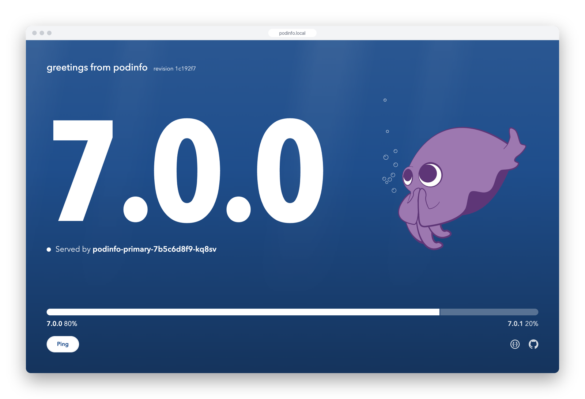

# podinfo

[](https://github.com/stefanprodan/podinfo/blob/master/.github/workflows/e2e.yml)
[](https://github.com/stefanprodan/podinfo/blob/master/.github/workflows/test.yml)
[](https://github.com/stefanprodan/podinfo/blob/master/.github/workflows/cve-scan.yml)
[](https://hub.docker.com/r/stefanprodan/podinfo)
[](https://github.com/stefanprodan/podinfo/attestations)
[](https://deepwiki.com/stefanprodan/podinfo)

Podinfo is a tiny web application made with Go that showcases best practices of running microservices in Kubernetes.
Podinfo is used by CNCF projects like [Flux](https://github.com/fluxcd/flux2) and [Flagger](https://github.com/fluxcd/flagger)
for end-to-end testing and workshops.



### Features

* [HTTP and gRPC API](docs/api.md) for testing clients, proxies and service meshes: echo, headers, status codes, delays, chunked responses, WebSockets and JWT tokens
* Chaining of instances over HTTP and gRPC, each one calls its backends and passes on the trace context, to simulate a microservices topology
* Health checks (readiness and liveness)
* Graceful shutdown on interrupt signals
* File watcher for secrets and configmaps
* Instrumented with Prometheus and [OpenTelemetry](docs/opentelemetry.md) (traces, metrics and logs over OTLP)
* Structured logging with zap
* 12-factor app with viper
* Fault injection (random errors and latency)
* TLS and [SPIFFE mTLS](docs/spiffe.md) on the HTTPS and gRPC ports, with X.509 SVIDs from the SPIFFE Workload API
* Redis and Valkey [cache](docs/cache.md) in standalone, Cluster and Sentinel mode, with TLS and mTLS
* [Web UI](docs/web-ui.md) embedded in the binary, with no external requests
* Swagger UI at `/swagger/`
* Timoni, Helm and Kustomize [installers](docs/install.md)
* End-to-End testing with Kubernetes Kind and Helm
* Multi-arch container image with Docker buildx and GitHub Actions
* Container image signing with Sigstore cosign
* SBOMs and SLSA Provenance embedded in the container image
* CVE scanning with govulncheck

### Guides

* [Getting started with Timoni](https://timoni.sh/quickstart/)
* [Getting started with Flux](https://fluxcd.io/flux/get-started/)
* [Progressive Delivery with Flagger and Linkerd](https://docs.flagger.app/tutorials/linkerd-progressive-delivery)
* [Automated canary deployments with Kubernetes Gateway API](https://docs.flagger.app/tutorials/gatewayapi-progressive-delivery)

### Install

To install Podinfo on Kubernetes the minimum required version is **Kubernetes v1.23**
with Helm and Kustomize, and **Kubernetes v1.25** with Timoni.

#### Timoni

Install with [Timoni](https://timoni.sh):

```bash
timoni -n default apply podinfo oci://ghcr.io/stefanprodan/modules/podinfo
```

#### Helm

```bash
helm upgrade --install --wait podinfo --namespace default \
oci://ghcr.io/stefanprodan/charts/podinfo
```

#### Kustomize

```bash
kubectl apply -k github.com/stefanprodan/podinfo//kustomize
```

#### Docker

```bash
docker run -dp 9898:9898 stefanprodan/podinfo
```

See the [install guide](docs/install.md) for the Helm repository, a frontend with a backend and a cache,
and continuous delivery with Flux.

### License

Podinfo is licensed under the [Apache License 2.0](LICENSE).
