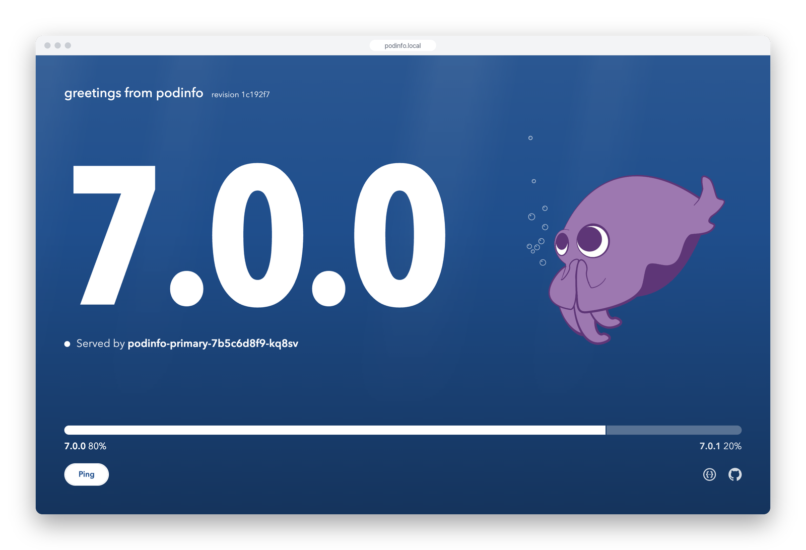
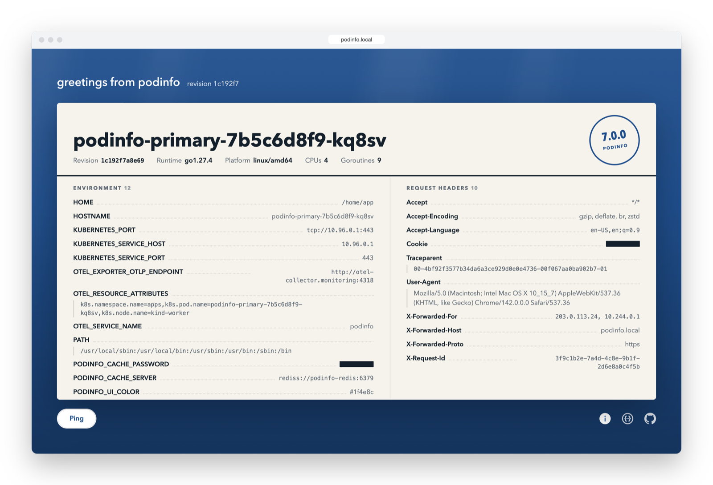

# Podinfo Web UI

Podinfo serves its web UI at `/` to browsers, other clients get the runtime information as JSON.
The UI is plain HTML, CSS and JavaScript embedded in the binary, and makes no requests to other origins.

The page polls the API every two seconds and shows the version and the pod that answered.
The bar shows each version's share of the last 30 responses, so a canary or blue/green rollout
is visible as it happens. When the API stops answering, the page says since when, dims the
stale data and recovers on its own.

The Ping button posts to `/api/echo`, which forwards the call to the backends set with `--backend-url`.

## Spec sheet

The info button opens a spec sheet of the pod that answered: the runtime information, the environment
variables and the request headers, with secret values masked. It is refreshed on every poll from `/api/pod`.

## Configuration

| Flag           | Description                                                                              |
|----------------|------------------------------------------------------------------------------------------|
| `--ui-color`   | Background color, defaults to the blue `#1f4e8c`; `#17694f` is the green that goes with it |
| `--ui-message` | Greeting, defaults to `greetings from podinfo`                                           |
| `--ui-logo`    | Image URL, defaults to the embedded one                                                  |

The text color adapts to the background. The Helm chart sets the three flags from its `ui` values, the Timoni module sets the color and the message.

## Demo

To see the UI during a canary release without a cluster, run `make run-ui-demo` and open `http://localhost:9898`.
